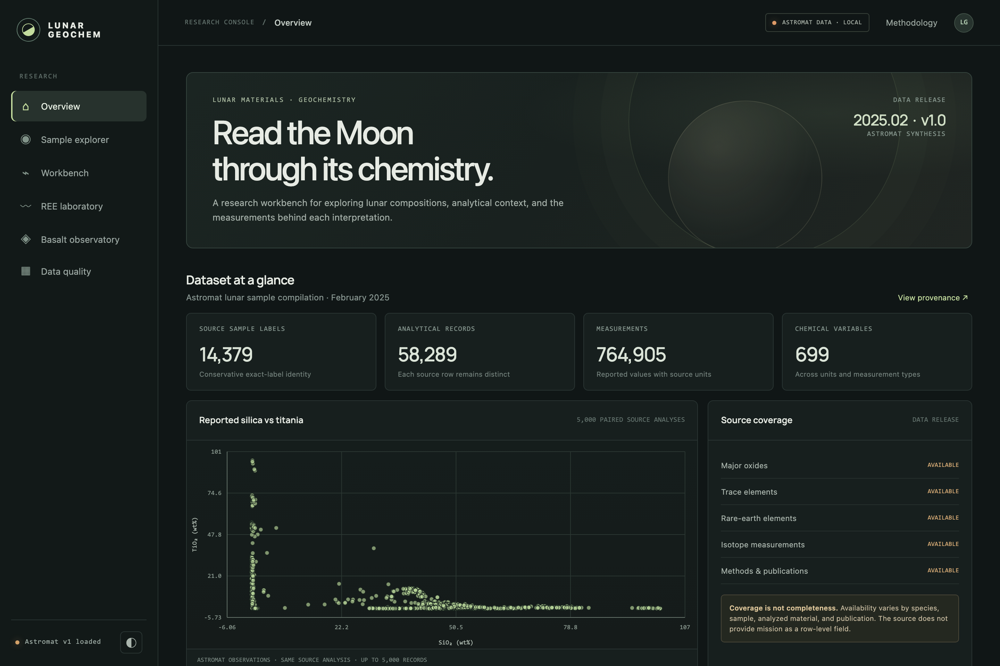
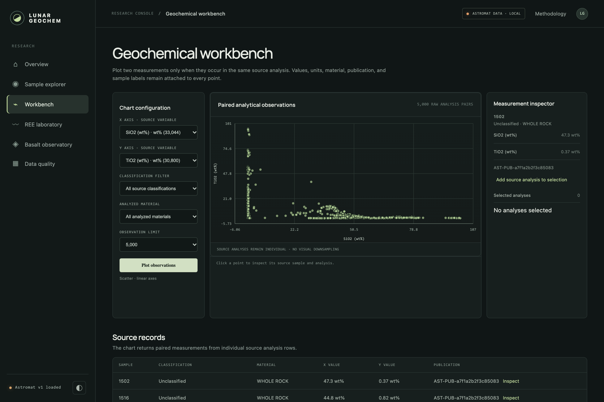
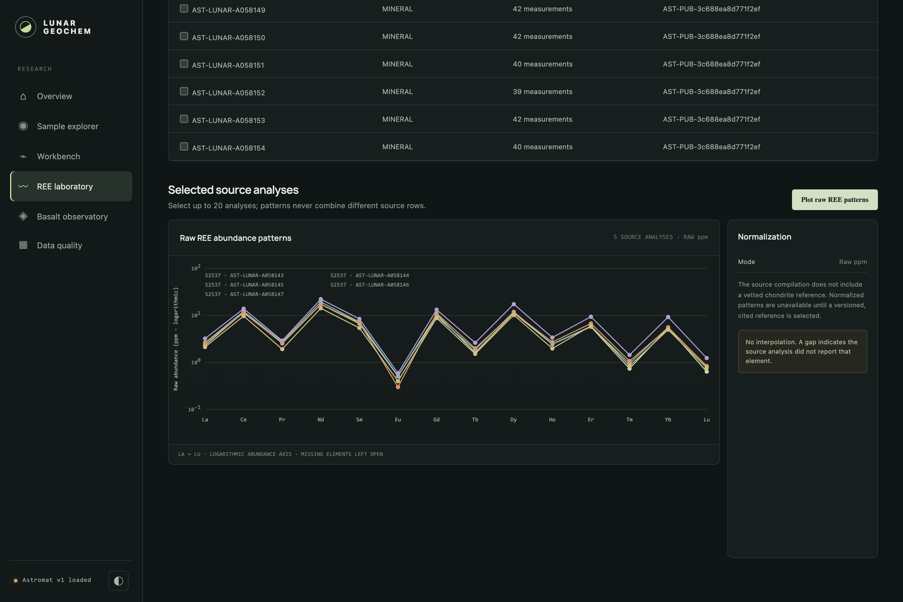
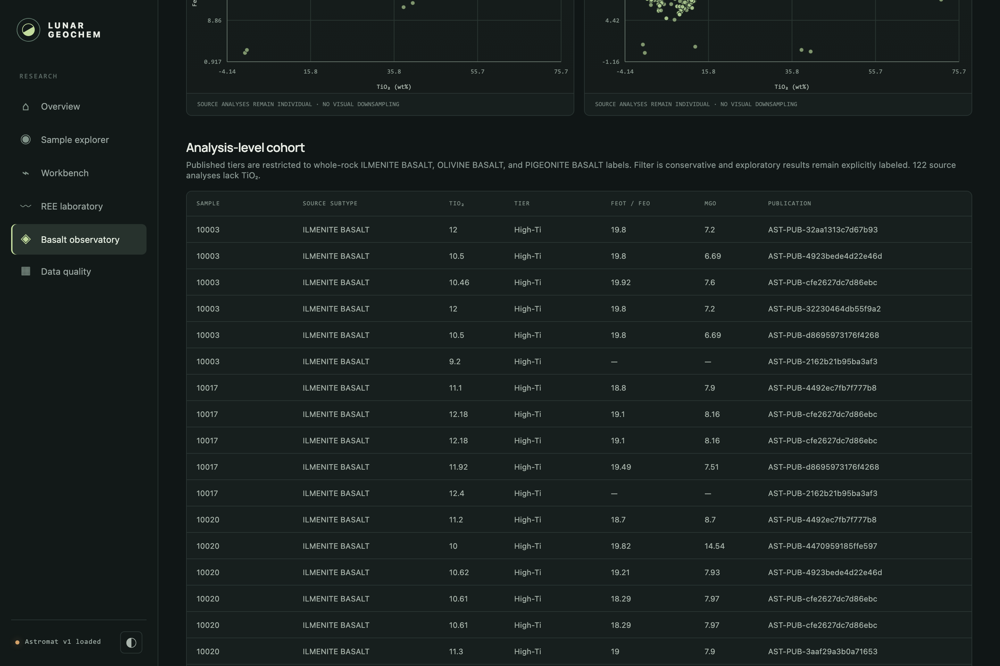
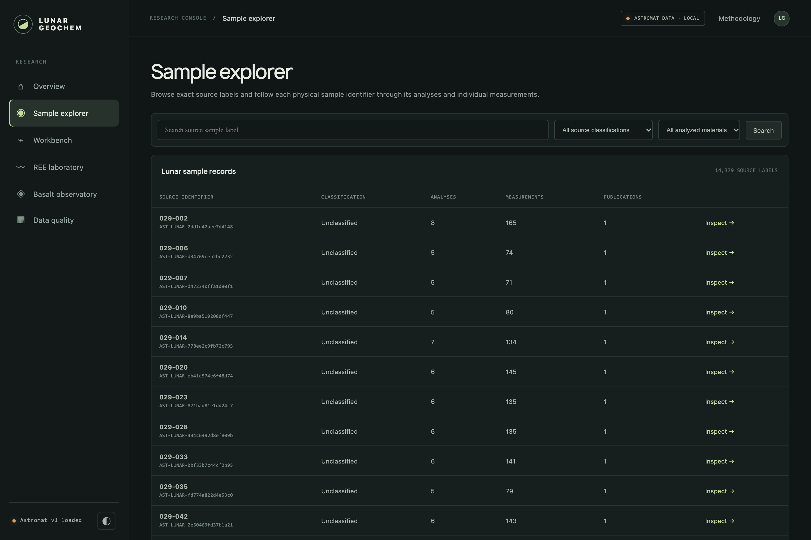
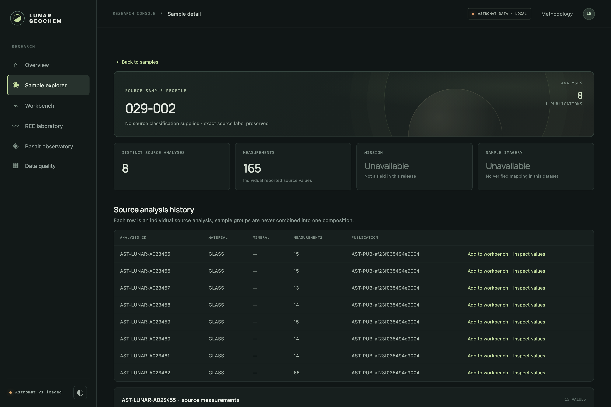
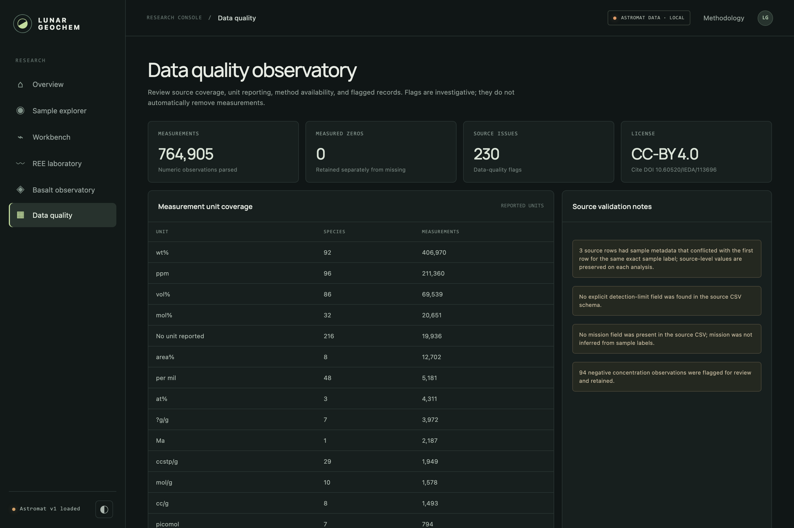

# Lunar Geochemistry Lab

A reproducible, local-first research workbench and analytical query engine for exploring the **Astromat Lunar Synthesis compilation** (EarthChem Library dataset 3696, DOI: [10.60520/IEDA/113696](https://doi.org/10.60520/IEDA/113696)). Built on DuckDB, Zstandard Parquet, and vanilla Web standards, it preserves source geochemical analyses as individual observations without artificial compositional averaging, loss of analytical method context, or silent imputation.



---

## The Problem It Solves

Lunar geochemistry spans over five decades of analytical data across Apollo missions, Luna sample returns, and lunar meteorites. When aggregating this data, traditional compilations often suffer from:

1. **Artificial Compositional Averaging**: Blending multiple distinct analyses into synthetic "average sample compositions" that obscure intra-sample heterogeneity, mineral zoning, and experimental variance.
2. **Loss of Analytical Lineage**: Detaching reported values from their instrumental method (EPMA, XRF, INAA, ICP-MS), reporting laboratory, uncertainty estimates, and primary literature citations.
3. **Imputation Hazards**: Substituting missing values with zeros, inferring unverified detection limits, or guessing mission metadata from ambiguous sample names.

**Lunar Geochemistry Lab** provides an auditable local workbench that queries 58,289 source analysis rows, 764,905 numeric measurements, and 699 chemical variables with zero external cloud dependencies. Every plotted point, table row, and statistical query remains strictly tied to its exact source analysis, publication DOI, and reported laboratory method.

---

## Key Features

- **Local-First Analytical Engine**: Sub-second queries over DuckDB columnar tables and streaming Zstandard-compressed Parquet datasets.
- **Strict Analytical Lineage**: One source CSV row equals one analysis record. Distinct analyses are never pseudo-replicated or artificially merged.
- **Geochemical Workbench**: Plot paired observations across any two chemical variables with real-time classification filters, material selection, and single-point analytical record inspection.
- **Rare-Earth Element (REE) Laboratory**: Multi-curve logarithmic abundance patterns (La through Lu) preserving gaps for missing elements and displaying characteristic Europium/Cerium anomaly signatures.
- **Neal & Taylor (1992) Basalt Observatory**: Conservative petrological classification of whole-rock mare basalts into Very Low-Ti (<1 wt%), Low-Ti (1–6 wt%), and High-Ti (>6 wt%) tiers, with paired bivariate plots against total Fe (FeOT/FeO) and MgO.
- **Exact-Label Sample Explorer**: Search and inspect 14,379 exact source sample labels, with analysis histories, mineral targets, and measurement uncertainty records.
- **Data Quality Observatory**: Comprehensive audit trail monitoring reported unit coverage, zero measurements vs. missing values, and data-quality flags.
- **Provenance Verification**: Automated checksum validation (SHA-1 and SHA-256) of the official Astromat/EarthChem release archive with idempotent rebuild caching.

---

## Visual Showcase

### Geochemical Workbench

Pair any two chemical variables across identical analytical runs. Interactive scatter plots render without downsampling, allowing researchers to click individual data points and inspect sample provenance, reported units, and literature citations.



### Rare-Earth Element (REE) Laboratory

Compare raw ppm rare-earth element abundances (La → Lu) on a logarithmic scale across multiple analyses. Gaps are faithfully left open where elements were unmeasured, ensuring no artificial interpolation is introduced.



### Basalt Observatory (Neal & Taylor 1992)

Curated whole-rock mare basalt cohort comparing reported TiO₂ against total iron (858 analyses) and MgO (865 analyses), stratified by established petrological Ti thresholds.



### Sample Explorer & Analytical History

Navigate physical lunar specimens by exact source label, following each physical sample through its individual analyses, mineral phases, and primary publication sources.

|                     Sample Explorer                      |              Sample Measurement Detail               |
| :------------------------------------------------------: | :--------------------------------------------------: |
|  |  |

### Data Quality Observatory

Inspect reported unit coverage (wt%, ppm, vol%, mol%, per mil), quality flags, and source validation warnings.



---

## Architecture & Technology Stack

```
lunar-geochem-lab/
├── index.html, styles.css, app.js     # Zero-dependency responsive UI (SVG plots, CSS variables)
├── server.py                          # Multi-threaded local HTTP server
├── lunar_lab/
│   ├── api.py                         # Parameterized, read-only HTTP API over DuckDB
│   ├── ingest.py                      # Resumable download, checksum verification & ETL pipeline
│   └── science.py                     # Geochemical helpers (Mg#, REE anomalies, ternary closure)
├── tests/                             # Comprehensive test suite (API, ingestion, science)
└── data/
    ├── raw/                           # Original Astromat .tar.gz archive & terms of use
    └── processed/                     # lunar_geochem.duckdb, Parquet tables & manifest.json
```

- **Database & Query Layer**: [DuckDB](https://duckdb.org/) for in-process analytical SQL; [Apache Parquet](https://parquet.apache.org/) with Zstandard compression for open data portability.
- **Backend API**: Python 3.10+ standard library `http.server.ThreadingHTTPServer` with strict input validation, parameterized queries, and read-only database connections.
- **Frontend Interface**: Native ECMAScript modules, CSS Grid/Flexbox design system, and dynamic SVG data visualizations with zero third-party client dependencies.

---

## Quick Start

### 1. Prerequisites

- Python 3.10 or later
- Node.js 18+ (optional, for development syntax validation and headless screenshot capture)

### 2. Environment Setup

Clone the repository and install the analytical dependency:

```bash
# Create and activate virtual environment
python3 -m venv .venv
source .venv/bin/activate

# Install package in editable mode (installs duckdb)
pip install -e .
```

### 3. Acquire and Process Dataset

Download the official Astromat lunar dataset (5.45 MB compressed archive containing the 230 MB CSV) and stream it into normalized tables:

```bash
# Download official release with license acceptance
python -m lunar_lab.ingest download --directory data/raw --format tar.gz --accept-terms

# Process wide source CSV into normalized DuckDB and Parquet tables
python -m lunar_lab.ingest process data/raw/all_dataset_3696.tar.gz --output data/processed
```

_Note: Processing is deterministic and idempotent. If the archive checksum and ETL version match the manifest, existing verified outputs are reused._

### 4. Run the Research Console

Start the local server:

```bash
python server.py
```

Open your browser at **`http://127.0.0.1:8000`** (or specify a custom port using `LUNAR_LAB_PORT=8008 python server.py`).

---

## REST API Reference

The local server exposes a read-only, parameterized JSON API under `/api/v1/`:

| Endpoint                            | Method | Query Parameters                                | Description                                                   |
| :---------------------------------- | :----- | :---------------------------------------------- | :------------------------------------------------------------ |
| `/api/v1/health`                    | `GET`  | —                                               | Health check and dataset load status.                         |
| `/api/v1/datasets`                  | `GET`  | —                                               | Provenance metadata and processing manifest.                  |
| `/api/v1/overview`                  | `GET`  | —                                               | Summary counts, unit distributions, and material types.       |
| `/api/v1/samples`                   | `GET`  | `q`, `subtype`, `material`, `page`, `page_size` | Paginated search across exact source sample labels.           |
| `/api/v1/samples/<id>`              | `GET`  | —                                               | Specimen metadata and analytical counts.                      |
| `/api/v1/samples/<id>/analyses`     | `GET`  | `limit`                                         | Individual source analyses associated with a specimen.        |
| `/api/v1/samples/<id>/measurements` | `GET`  | `analysis_id`, `limit`                          | Reported values, units, methods, labs, and uncertainties.     |
| `/api/v1/species`                   | `GET`  | `q`, `unit`                                     | Catalog of chemical species with measurement counts.          |
| `/api/v1/facets`                    | `GET`  | —                                               | Available classifications, materials, and units.              |
| `/api/v1/query/observations`        | `GET`  | `x`, `y`, `subtype`, `material`, `limit`        | Paired measurements joined strictly within the same analysis. |
| `/api/v1/analysis/ree`              | `GET`  | `analysis_ids`                                  | Raw REE abundances (ppm) ordered La through Lu.               |
| `/api/v1/analysis/basalts`          | `GET`  | `group`, `subtype`                              | Whole-rock mare basalts with Neal & Taylor Ti tiers.          |
| `/api/v1/data-quality`              | `GET`  | —                                               | Measurement status, zero counts, and quality flags.           |

---

## Scientific Helpers & Formulation

The package includes auditable scientific calculation helpers in `lunar_lab/science.py`:

- **Magnesium Number (`Mg#`)**: Molar ratio of $MgO$ to total iron ($FeO_T$):
  $$\text{Mg number} = 100 \times \frac{\mathrm{MgO} / 40.3044}{(\mathrm{MgO} / 40.3044) + (\mathrm{FeO}_T / 71.844)}$$
- **Rare-Earth Element Anomalies**: Geometric interpolation over chondrite-normalized abundances:
  $$\text{Eu} / \text{Eu}^* = \frac{\text{Eu}_N}{\sqrt{\text{Sm}_N \times \text{Gd}_N}}, \quad \text{Ce} / \text{Ce}^* = \frac{\text{Ce}_N}{\sqrt{\text{La}_N \times \text{Pr}_N}}$$
- **Ternary Composition Closure**: Validates non-negativity and strictly normalizes components $(a, b, c)$ to unit sum:
  $$\tilde{x}_i = \frac{x_i}{a + b + c}$$
- **Basalt Titanium Classification**: Evaluated according to Neal & Taylor (1992):
  - **Very Low-Ti**: $\text{TiO}_2 < 1.0\text{ wt}\%$
  - **Low-Ti**: $1.0\text{ wt}\% \le \text{TiO}_2 \le 6.0\text{ wt}\%$
  - **High-Ti**: $\text{TiO}_2 > 6.0\text{ wt}\%$

---

## Testing & Quality Assurance

The repository includes a comprehensive automated test suite covering scientific calculations, ETL idempotency, and API endpoints:

```bash
# Run all unit tests
.venv/bin/python -m unittest discover -s tests -v

# Verify Python syntax and bytecode compilation
.venv/bin/python -m py_compile server.py lunar_lab/*.py tests/*.py

# Verify frontend JavaScript syntax
node --check app.js
```

---

## Data Source & Attribution

- **Dataset**: _Astromat Synthesis Compilation: Lunar samples v.1 February 2025_
- **Release Version**: 1.0 (2025-02-26)
- **DOI**: [10.60520/IEDA/113696](https://doi.org/10.60520/IEDA/113696)
- **Repository Record**: [EarthChem Library dataset 3696](https://ecl.earthchem.org/view.php?id=3696)
- **Data License**: [Creative Commons Attribution 4.0 International (CC-BY-4.0)](https://creativecommons.org/licenses/by/4.0/)

_When publishing research derived from this workbench, cite the Astromat release DOI and the primary literature sources identified in the inspection panel._

---

## License & Custom Work

[](mailto:work@withrana.com) [](https://www.linkedin.com/in/workwithrana)
[](https://www.upwork.com/freelancers/~01bbcf6edb91a8df5f)
[](https://contra.com/ranajahanzaib/)

**License:** MIT, see [LICENSE](LICENSE). Free for personal and commercial use.

**Author:** Rana Jahanzaib

**Need this built for your stack?** Email me what you're working on: work@withrana.com
